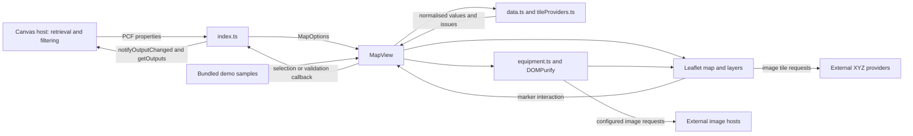

# Architecture

Checked against source on 2026-11-12. This describes the implementation, not an intended future design. Public property formats and maker examples remain in the [README](../README.md).

## Responsibilities and dependencies

| Module | Responsibility |
| --- | --- |
| [ControlManifest.Input.xml](../LeafletMap/ControlManifest.Input.xml) | Input/output names, Canvas defaults, external domains, CSS and code resources. |
| [index.ts](../LeafletMap/index.ts) | `StandardControl` lifecycle, host input mapping, resize allocation and four output values. |
| [mapView.ts](../LeafletMap/mapView.ts) | Leaflet map, layer state, selection, validation aggregation, fitting, keyboard/touch interaction and teardown. |
| [data.ts](../LeafletMap/data.ts) | JSON boundary validation and normalisation for assets, image/HTML catalogues and GeoJSON; URL policy. No DOM rendering. |
| [equipment.ts](../LeafletMap/equipment.ts) | Marker DOM, trusted built-in SVG drawings, fuel/status presentation, DOMPurify template sanitisation and placeholder substitution. |
| [tileProviders.ts](../LeafletMap/tileProviders.ts) | Provider validation and public-token substitution; Leaflet layer construction stays in `MapView`. |
| [CSS](../LeafletMap/css/LeafletMap.css) | Map layout and marker presentation, alongside the vendored [Leaflet stylesheet](../LeafletMap/css/leaflet.css). |
| [preview/main.ts](../preview/main.ts) | Local host simulation and `window.preview` test interface. Filters and details here are outside the shipped control. |
| [samples](../samples/equipment.json) | Bundled equipment/roads and maker reference inputs. Changing equipment or roads changes the demo compiled into the control. |
| [solution project](../solution/solution.cdsproj) | Managed/unmanaged packaging of the referenced PCF project. No app backend or data schema is defined here. |

## Lifecycle and data flow

1. `init` saves the output notifier, enables host resize tracking, constructs `MapView` and calls `updateView`. The adapter's output state begins empty with version zero. No PCF state dictionary is persisted.
2. `updateView` reads raw properties, translates them to `MapOptions`, calls `update`, then passes allocated dimensions to `resize`. Manifest defaults and raw-value fallback logic are distinct: for example `UseDemoData` and `ShowBasemap` require raw `true` in the adapter.
3. `MapView.update` chooses demo samples independently for blank asset/shape inputs. It updates provider/basemap state, then compares a serialised input key and label visibility with previous values. Unchanged data avoids parsing and rebuilding.
4. A relevant change parses all data/catalogues, aggregates issues (including unresolved HTML keys), replaces shape/marker layers and reconciles the old selection by ID and normalised record contents. Removing a selected record clears it; changing it refreshes the output. Selected image/HTML catalogue contents are not embedded in that record.
5. Data-key changes trigger fitting to combined asset/shape bounds. The key also includes templates, catalogue/provider configuration and label position/offsets, so those changes can refit the map too. Label visibility alone rebuilds without requiring a refit after the initial fit. Layer switching preserves selection.
6. Marker click, Enter or Space selects; map-background click or Escape clears an existing selection. The callback publishes ID and normalised JSON and increments `SelectionVersion`, including repeat selection. Validation changes notify separately only when the message changes; consumers may observe validation and selection notifications during one update.
7. `ResizeObserver` and a coalesced animation frame invalidate Leaflet size. Positive host dimensions become pixel sizes; otherwise the view uses 100%. `destroy` cancels the frame, disconnects the observer, removes the map and root DOM.

There is no clustering, incremental marker diff, worker, persistence or fetch loop. The parser validates coordinate ranges and geometry structure, including closed polygon rings, but does not establish topology correctness or enforce payload/recursion limits.

## Rendering and trust boundaries

Record names, labels and shape tooltips use text nodes. Templates pass through DOMPurify with explicit tag/attribute allowlists, then text placeholders are replaced with text. Built-in names override matching `fields` keys. Only a complete `{{imageUrl}}` image-source placeholder is dynamic in attributes; other placeholder-bearing attributes are removed.

`safeImageUrl` accepts credential-free HTTPS URLs and PNG/JPEG/WebP base64 data URLs. This restricts URL schemes, not remote content type, availability or authorization. SVG data URLs are rejected; built-in SVG comes from trusted source constants. Template `style` and `class` remain maker-authored presentation; this is not a CSS isolation boundary. Downstream consumers must still treat original HTML in `SelectedAssetJson` as untrusted.

The known-equipment marker removes a failed external image to reveal its built-in SVG. Generic/template images have no equivalent implemented error fallback. GeoJSON styling accepts bounded numbers, selected line-style values and supported named/hex colours; invalid values use defaults. Style alias resolution is per alias: nested `style.color` beats top-level `color`, but top-level `color` is checked before nested `style.stroke`.

## External integrations and auxiliary surfaces

- Runtime dependencies are Leaflet and DOMPurify, bundled from npm. The PCF makes tile/image requests; no connector, PCF Web API or Dataverse runtime calls occur.
- OpenStreetMap is built in. EOX, NASA and Mapbox are declared domains but become selectable only when configured. Provider URLs support XYZ placeholders, optional URL-encoded public keys, tile size and zoom offset; no vector tiles, custom headers or auth exchange exists. HTTP is accepted by the parser; production host networking can prevent it from loading.
- The manifest declares external usage independently of the current basemap toggle. New provider/image domains require reviewing that declaration and rebuilding. It is not a runtime hostname allowlist enforced by `safeImageUrl` or `parseTileProviders`.
- Custom attribution is escaped and displayed as text. The intended demo uses OpenStreetMap and optionally Mapbox with a user-supplied public key. Provider-required links/logos are not implemented by the generic field; verify current Mapbox requirements and address them before distributing that configuration. Provider terms were not audited in this documentation pass. Demo images are supplied from a Power Apps collection and can serialize as data URLs or HTTPS references.
- Tile errors display a local warning without clearing data or becoming `ValidationMessage`. Disabling basemaps removes tile layers; it does not suppress external marker images or resources referenced by template CSS.
- [testMapbox.html](../testMapbox.html) is a separate CDN-backed experiment with Mapbox tiles and forward geocoding. Its ignored `mapbox.local.js` token is not PCF configuration. Geocoding is not a control capability.
- [sandbox.html](../sandbox.html) is a minimal alternate preview; browser regression tests target the richer root preview. [SVG conversion](../scripts/convert-svg-to-png.mjs) is a local Playwright utility, not a build step. The maintainer chose to remove `portfolio-dist/` alongside its deleted source; the compiled files remain pending removal.

See [development](development.md) for verification boundaries.
